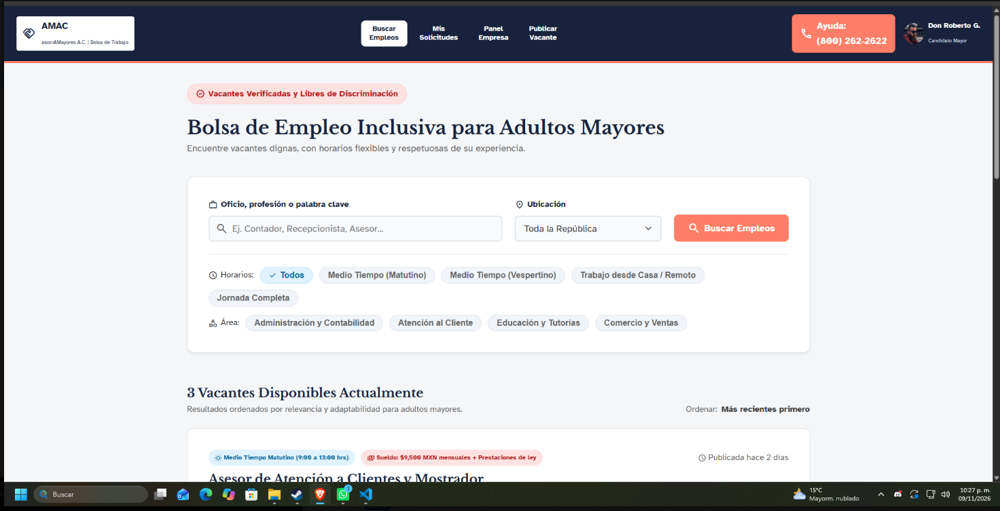
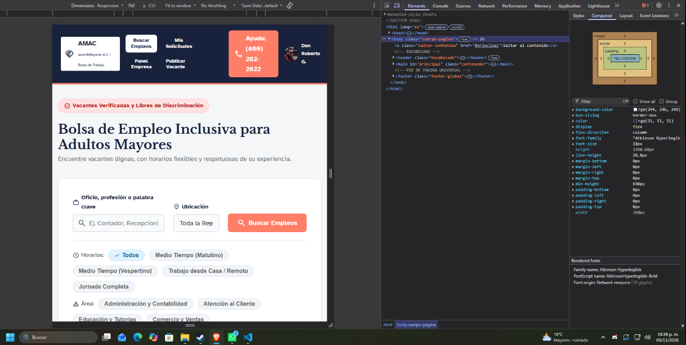
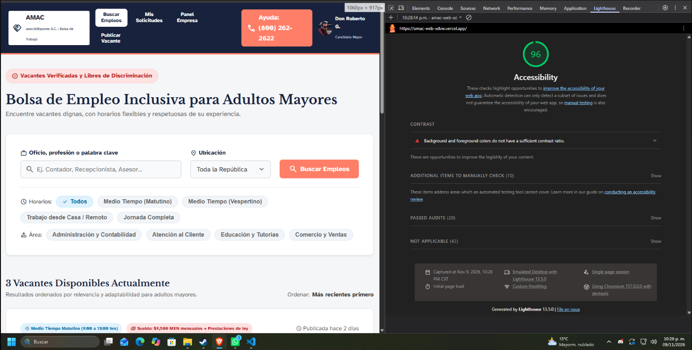

# AMAC - Bolsa de Empleo Inclusiva para Adultos Mayores

Plataforma de empleo diseñada bajo estrictos estándares de accesibilidad visual y motriz, orientada a conectar a adultos mayores con empresas que ofrecen oportunidades laborales dignas y libres de discriminación.

## Integrantes del Equipo y Aportaciones

* **Miguel Angel Escobar Maldonado**: Creacion Base de los archivos de CSS y creacion de las pantallas Detalle de vacante, Mis solicitudes, Listado de vacantes, Panel de vacantes
* **Edgar Antonio Cristóbal Maldonado:** Creacion de pantallas registro candidato, perfil-empresa
* **San Juana Abigail González Reyes:** Hizo el Read me, superviso que las pantallas fueran fieles a lo que se entrego en Figma
* **Johan Treviño Alvarado:** Creacion de pantallas de "Mi perfil" de candidato,

## Tipografías y Paleta de Colores (Variables CSS)

El sistema de diseño está construido para usar alto contraste.

### Tipografías

* **Primaria (Lectura/Cuerpo):** Atkinson Hyperlegible, diseñada específicamente para máxima distinción de caracteres y legibilidad en adultos mayores var(--fuente-base).
* **Secundaria (Títulos/Destacados):** Libre Baskerville, utilizada para aportar seriedad y jerarquía var(--fuente-titulos)
* **Iconografía:** Material Symbols Outlined escalados.

### Paleta de Colores Globales

Los colores se manejan a través de variables CSS en la raíz (:root) para mantener consistencia:

* **--color-primario :** Usado para encabezados, textos principales, banners de ayuda y botones de acción secundaria.
* **--color-acento :** Usado para botones principales (Call to Action), iconos destacados y enlaces importantes.
* **--color-superficie / --color-fondo :** Fondos de tarjetas (#ffffff) y de la aplicación (#f8fafc o #f1f5f9) para reducir la fatiga visual.
* **--color-texto / --color-texto-claro:** Grises oscuros (#1e293b, #334155) para garantizar un ratio de contraste superior a 4.5:1.
* **--color-borde:** Gris suave para delimitar tarjetas y formularios sin saturar la vista.
* **Colores Semánticos (Estados):**
  * Éxito/Activo: Verdes (**--bg-concluido**, #16a34a)
  * Información/Entrevista: Azules claros (**--bg-info,** #0369a1)
  * Alerta/Revisión: Rojos claros (**--bg-error**, #b91c1c)

## Lista de Componentes Reutilizables Identificados (Sección 5.4)

El archivo **componentes.css** centraliza los siguientes elementos modulares, diseñados para ser invocados en cualquier vista mediante clases semánticas:

1. **Botones (.boton):**
   * Tienen un área de interacción táctil mínima de 48px (**min-height: 48px**).
   * Variantes: **.boton--naranja** (Primario), **.boton--oscuro** (Secundario)**, .boton--outline** (Terciario/Fantasmas), y .btn-blanco.
2. **Tarjetas / Cards (.tarjeta):**
   * Contenedores base con sombras sutiles y bordes redondeados (**.tarjeta-info, .tarjeta-outline, .tarjeta-registro, .tarjeta-vacante-listado**).
3. **Etiquetas y Badges de Estado (.etiqueta, .tag-aliados):**
   * estatus de postulaciones o vacantes (ej. **--revision, --entrevista, --concluida, --activa, --pausada**).
4. **Formularios (.campo-formulario, .input-simple):**
   * Entradas de texto de gran tamaño (48px) con alto contraste al enfocar **(:focus).**
   * Componentes compuestos: **.input-con-icono** (input con icono interno).
   * Opciones seleccionables ampliadas: **.opcion-tarjeta**.
5. **Métricas de Tablero (.tarjeta-metrica):**
   * Cajas de resumen numérico para paneles empresariales, con variantes de color (**--blanca, --azul, --roja**).
6. **Alertas y Notificaciones (.alerta, .alerta-exito):**
   * Mensajes de retroalimentación en línea, auto-contenidos, con iconos semánticos y botón de cierre táctil.
7. **Banners CTA (Call to Action) (.cta-dudas, .banner-ayuda):**
   * Cajas de ayuda telefónica y soporte resaltadas en bloque azul marino, reutilizadas al final de flujos complejos.
8. **Paginación y Navegación (.paginacion, .btn-paginacion, .panel-sidebar):**
   * Menús de navegación laterales y controles de paginación inferiores estandarizados y accesibles por teclado.

## Capturas de Interfaz (index.html)

### Vista de Escritorio (Desktop)

### Vista Móvil (Celular)

## Accesibilidad (Lighthouse Score)

